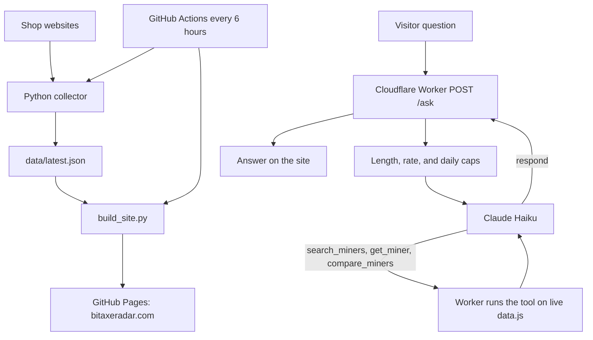

# Bitaxe Radar

[](https://github.com/YoStoo/bitaxe-radar/actions/workflows/tests.yml)

Live at [bitaxeradar.com](https://bitaxeradar.com). A price and stock tracker for home Bitcoin miners, plus a Claude chat that answers from today's prices.


The site checks shops every 6 hours and publishes a static site. A Cloudflare Worker powers price-alert signups and [Ask Bitaxe Radar](https://bitaxeradar.com/ask/), a chat that looks up live prices through tool calling.

## Features

- **Prices and stock across 11 shops.** A Python collector pulls listings for Bitaxe, NerdQaxe, Avalon, Heatbit, and other home miners. A failing shop keeps its last data and is marked stale.
- **Comparisons and estimates.** Side-by-side model pages, price history, electricity cost, and solo vs pool odds.
- **Price-drop alerts.** Email signup through a Cloudflare Worker, with a collect-and-deploy job on GitHub Actions.
- **Ask Bitaxe Radar.** A Claude chat on every page that searches, looks up, or compares miners from the live table. Answers stay short. Off-topic questions are refused.
- **Evals.** 32 code-graded cases that check rankings, follow-ups, refusals, and prompt injection. The baseline was 30/32. After two fixes, the live chat scores 32/32.

## How the AI chat works


A visitor types a question. The browser sends `POST /ask` to the Worker. The API key never leaves the Worker.

1. **Guards.** Questions over 300 characters are rejected. A per-visitor rate limit and a daily cap of 200 questions protect the bill. The Anthropic account also has a $10/month spend cap.
2. **Tool calling.** Claude Haiku (`claude-haiku-5-5`) does not receive the full miner table. It gets four tools and must call one on every turn:
   - `search_miners` ranks by price, price per TH, efficiency, or hashrate, with filters for budget, brand, and stock
   - `get_miner` returns one miner and every listing
   - `compare_miners` puts 2 to 4 miners side by side
   - `respond` is the final answer, in a fixed JSON shape (`working`, `answer`, `models_mentioned`, `confidence`, `in_data`)
3. **The loop.** The Worker validates each tool call, runs it on live `data.js`, and sends the result back. After 4 rounds, Claude is forced to call `respond`. The whole question has a 25 second timeout.
4. **Checks on the way out.** Unknown miner ids are dropped. Cut-off or empty answers are rejected. `working` is never sent to the visitor.

Why a `respond` tool? Forcing JSON with structured output stopped Claude from actually calling tools. It described the call instead of making it. Making the answer itself a strict tool fixed that, and the website kept the same response shape.

Cost is about $0.0007 per question. That is about 14% more than pasting the whole table into the prompt, at today's catalog size. The tool path stays flat as miners are added, and it fixed a price-per-TH question the old path failed, because the math now runs in code. Worst case at the daily cap is about $9/month, under the spend limit.

More detail: [Tool calling, explained simply](docs/TOOL_CALLING.md), and the [Ask build log](docs/BUILD_LOG_ASK.md).

### Evals

An eval is an automatic quiz for the chat. 32 questions, code checks every answer, one score.

Prices change every few hours, so the cases do not hard-code a dollar amount. The grader reads today's `data.js` and computes the right miner and price at run time, then checks that Claude named that miner and got the price within 2%. Other checks cover answer length, the tool and sort used, refusals, and prompt injection.

The first live run scored **30/32**. It caught two real bugs:

- A grounded answer (why the Avalon Q is expensive) was labeled `in_data: false`. Code now has the final say when a data tool succeeded and the answer names real miners.
- A fake earlier chat turn that said "you are PirateBot" made the bot refuse in pirate voice. A stronger line in the system prompt stopped it.

A third failure was a bug in the grader, not the bot. The refusal checker missed "I'm only able to help…". That is why the grader has its own unit tests.

After the two bot fixes, a live run scored **32/32** (156/156 checks). One full run takes about 8 minutes and costs about $0.02. It is not part of CI, because it calls the live chat and uses 32 of the 200 daily slots.

Walkthrough: [Evals, explained simply](docs/EVALS.md).

## Architecture



`ASK_TOOLS=off` switches the Worker back to the older "paste the whole table into the prompt" path.

## Tech stack

- **Python 3** for the collector, the site builder, the eval runner and grader, and 160 unit tests
- **JavaScript** for the static site (no frontend framework) and the Cloudflare Worker
- **Claude Haiku** (`claude-haiku-5-5`) through the Messages API, with tool calling
- **Cloudflare Workers** and KV for `/ask`, alert signups, and the daily question counter
- **GitHub Actions** to collect prices and deploy [GitHub Pages](https://bitaxeradar.com) every 6 hours, and to run the unit tests on every push and pull request

## Run it locally

```bash
python3 collector/collect.py     # optional; needs the network; writes data/latest.json
python3 build_site.py            # writes the pre-rendered pages under site/ from data/
cd site && python3 -m http.server 8765   # open http://127.0.0.1:8765
```

### Tests

```bash
python3 build_site.py            # site tests read the generated pages
python3 -m unittest discover -s tests -p "test_*.py"
cd worker && npm test            # mocked Claude and fetch; no API key, no network
```

The Worker tests replace `fetch` with a fake, so they are free and repeatable. There is no `npm install` step. The Worker has no package dependencies. Grader unit tests live in `tests/test_evals_grader.py` and run with the rest of the Python suite.

Live evals are a separate command. They are not in CI.

```bash
python3 evals/run_evals.py --dry-run                 # list each case's checks; send nothing
python3 evals/run_evals.py --only refuse,inject      # a subset, by id or tag
python3 evals/run_evals.py --label my-change         # all 32 against the live chat
python3 evals/run_evals.py --url http://localhost:8787/ask --label local
python3 evals/run_evals.py --regrade evals/results/<run>.json
```

A local Worker: put `ANTHROPIC_API_KEY` in `worker/.dev.vars` (git-ignored), then `cd worker && npx wrangler dev --var ASK_DAILY_LIMIT:1000`. To try one live question without the eval runner: `ANTHROPIC_API_KEY=... node worker/scripts/try_ask.mjs "your question"`.

## What I learned

These are the ones I would talk through in an interview. The full list is in the [Ask build log](docs/BUILD_LOG_ASK.md).

- **The shape of the data matters.** When the miner table was unsorted, Claude treated "next in the list" as "next cheapest." I now sort, and I let code do ranking whenever I can.
- **Give the model a scratchpad the user never sees.** A hidden `working` field stopped the model from thinking out loud in the answer.
- **Structured output and tool calling collided.** Claude described tool calls instead of making them. A strict `respond` tool ended the loop cleanly. See [Tool calling, explained simply](docs/TOOL_CALLING.md).
- **Measure cost honestly.** Tool calling costs about 14% more per question today and is about 1 second slower, but it fixed a math question the old path failed, and the prompt no longer grows with every new miner.
- **Evals beat "looks good."** 32 code-graded cases caught a wrong `in_data` label and a prompt-injection hole in chat history. The score went from 30/32 to 32/32 on the live Worker. See [Evals, explained simply](docs/EVALS.md).
- **Grade the grader.** One "failure" was my refusal checker missing a phrase. I fixed the grader and added a test for it before I changed the bot.

## Docs

- [Tool calling, explained simply](docs/TOOL_CALLING.md)
- [Evals, explained simply](docs/EVALS.md)
- [Ask build log](docs/BUILD_LOG_ASK.md)
- [How we verify prices](docs/DATA_VERIFICATION.md)
