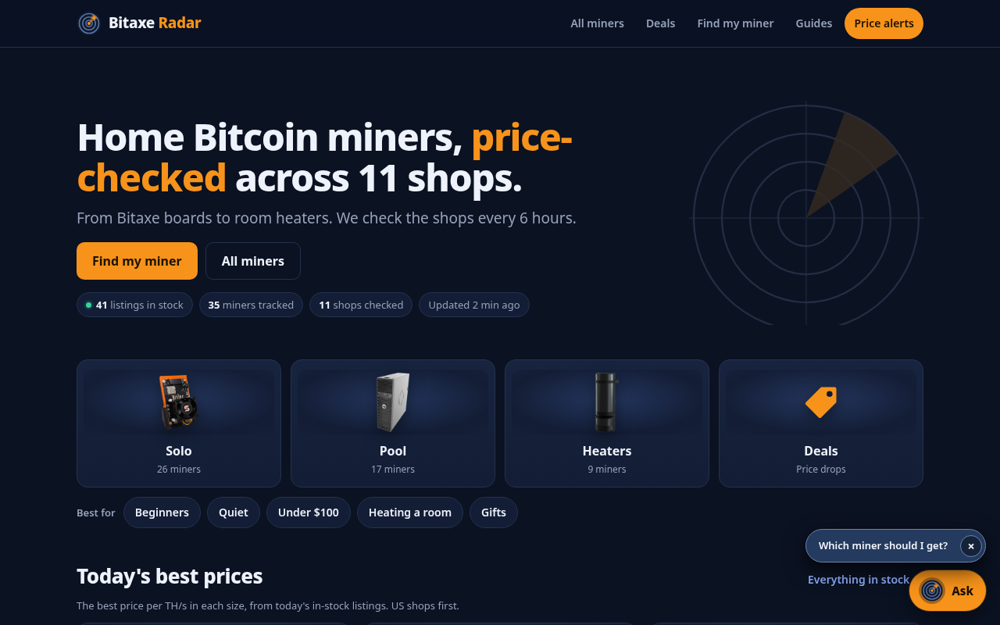
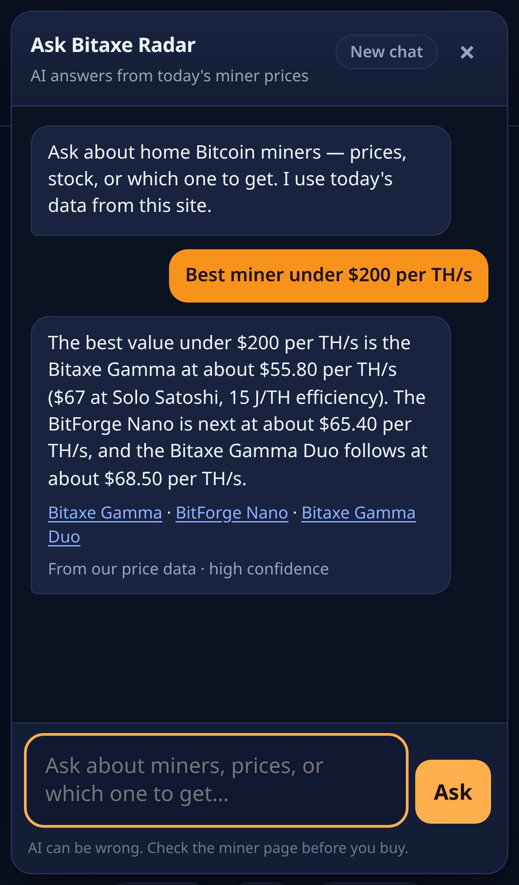
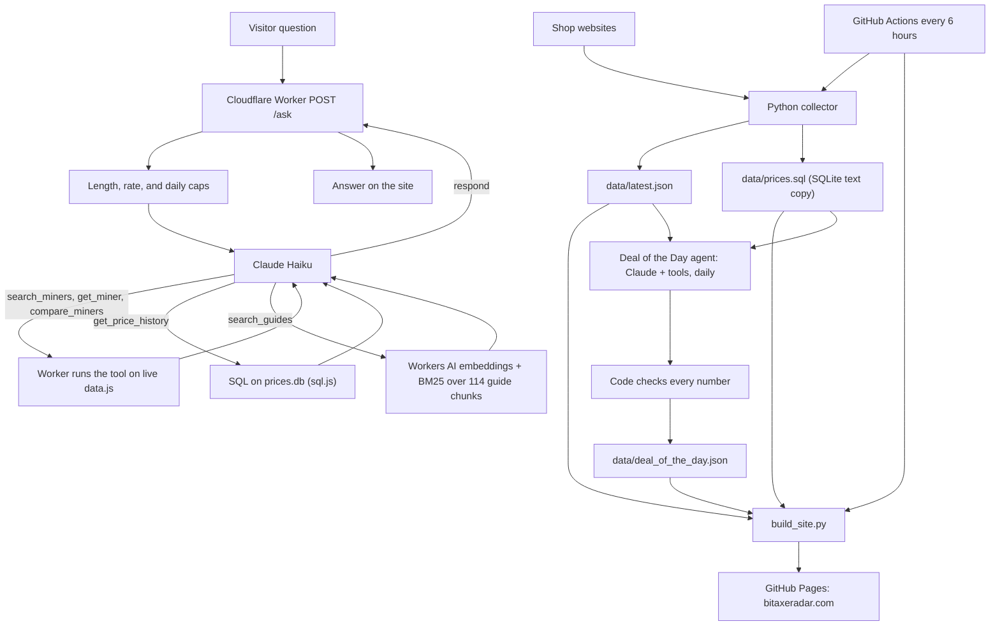

# Bitaxe Radar

[](https://github.com/YoStoo/bitaxe-radar/actions/workflows/tests.yml)

Live at [bitaxeradar.com](https://bitaxeradar.com). A price and stock tracker for home Bitcoin miners, plus a Claude chat that answers from today's prices.



The site checks shops every 6 hours and publishes a static site. A Cloudflare Worker powers price-alert signups and [Ask Bitaxe Radar](https://bitaxeradar.com/ask/), a chat that looks up live prices through tool calling, answers price-history questions with SQL, and answers how-to questions from the site's guides with RAG (cited sources).

## Features

- **Prices and stock across 11 shops.** A Python collector pulls listings for Bitaxe, NerdQaxe, Avalon, Heatbit, and other home miners. A failing shop keeps its last data and is marked stale.
- **Comparisons and estimates.** Side-by-side model pages, price history, electricity cost, and solo vs pool odds.
- **Price-drop alerts.** Email signup through a Cloudflare Worker, with a collect-and-deploy job on GitHub Actions.
- **Ask Bitaxe Radar.** A Claude chat on every page that searches, looks up, or compares miners from the live table. Answers stay short. Off-topic questions are refused.
- **SQL price history.** A SQLite database (miners, retailers, offers, daily price snapshots) updated every collector run, idempotently. The chat's `get_price_history` tool queries it. See [SQL, explained simply](docs/SQL.md).
- **RAG over the guides.** 114 guide passages, hybrid search (Workers AI embeddings + BM25, merged with reciprocal rank fusion), top 3 passages to Claude, citations checked in code. See [RAG, explained simply](docs/RAG.md).
- **Deal of the Day agent.** Once a day, after prices are collected, Claude runs a tool loop over today's prices and the SQL history, picks the in-stock miner furthest below its 14-day typical price, and writes a short summary. Code checks every price, % and shop before it's published, with one retry, then a template fallback. See [Deal agent, explained simply](docs/DEAL_AGENT.md). It only appears on days with a real deal (3%+ under typical); on other days the site shows nothing.
- **Evals.** 48 code-graded cases that check rankings, follow-ups, refusals, prompt injection, price history, and RAG retrieval, citations, grounding and "I don't know". See the scores below. A public dashboard (branch `feature/eval-dashboard`, not live yet) charts those scores over time and lists which questions failed: [Eval dashboard, explained simply](docs/EVAL_DASHBOARD.md).

## How the AI chat works



A visitor types a question. The browser sends `POST /ask` to the Worker. The API key never leaves the Worker.

1. **Guards.** Questions over 300 characters are rejected. A per-visitor rate limit and a daily cap of 200 questions protect the bill. The Anthropic account also has a $10/month spend cap.
2. **Tool calling.** Claude Haiku (`claude-haiku-5-5`) does not receive the full miner table. It gets six tools and must call one on every turn:
   - `search_miners` ranks by price, price per TH, efficiency, or hashrate, with filters for budget, brand, and stock
   - `get_miner` returns one miner and every listing
   - `compare_miners` puts 2 to 4 miners side by side
   - `get_price_history` runs SQL on the price database (start vs latest price, change, lows, cheapest shop over time)
   - `search_guides` retrieves the 3 most relevant guide passages (RAG) and returns guide ids to cite
   - `respond` is the final answer, in a fixed JSON shape (`working`, `answer`, `models_mentioned`, `guides_cited`, `confidence`, `in_data`)
3. **The loop.** The Worker validates each tool call, runs it on live `data.js`, and sends the result back. After 4 rounds, Claude is forced to call `respond`. The whole question has a 25 second timeout.
4. **Checks on the way out.** Unknown miner ids are dropped. A guide citation is kept only if `search_guides` really returned that guide, and the site shows it as a "Source" link. Cut-off or empty answers are rejected. `working` is never sent to the visitor.

Why a `respond` tool? Forcing JSON with structured output stopped Claude from actually calling tools. It described the call instead of making it. Making the answer itself a strict tool fixed that, and the website kept the same response shape.

Cost is about $0.0007 per question. That is about 14% more than pasting the whole table into the prompt, at today's catalog size. The tool path stays flat as miners are added, and it fixed a price-per-TH question the old path failed, because the math now runs in code. Worst case at the daily cap is about $9/month, under the spend limit.

More detail: [Tool calling, explained simply](docs/TOOL_CALLING.md), and the [Ask build log](docs/BUILD_LOG_ASK.md).

### Evals

An eval is an automatic quiz for the chat. 48 questions, code checks every answer, one score.

Prices change every few hours, so the cases do not hard-code a dollar amount. The grader reads today's `data.js` and computes the right miner and price at run time, then checks that Claude named that miner and got the price within 2%. Other checks cover answer length, the tool and sort used, refusals, and prompt injection.

The first live run scored **30/32**. It caught two real bugs:

- A grounded answer (why the Avalon Q is expensive) was labeled `in_data: false`. Code now has the final say when a data tool succeeded and the answer names real miners.
- A fake earlier chat turn that said "you are PirateBot" made the bot refuse in pirate voice. A stronger line in the system prompt stopped it.

A third failure was a bug in the grader, not the bot. The refusal checker missed "I'm only able to help…". That is why the grader has its own unit tests.

After the two bot fixes, a live run scored **32/32** (156/156 checks). One full run takes about 8 minutes and costs about $0.02. It is not part of CI, because it calls the live chat and uses daily question slots.

Then 6 price-history cases and 11 RAG cases were added (48 total). Before, the live chat scored 1/6 on history and 0/11 on RAG. On a test Worker, the full suite scored 47/48. The one failure was a code bug of mine: a guide citation was flipping a general-knowledge answer to "from our data", and I fixed it. The first live run after launch (Nov 10) scored 15/17 on the new cases. Two guide-grounded answers were labeled "not from our data". A one-line fix to the `in_data` field description made that 7/7 on a live re-check. Details: [SQL](docs/SQL.md), [RAG](docs/RAG.md).

Walkthrough: [Evals, explained simply](docs/EVALS.md). The public score page is documented in [Eval dashboard, explained simply](docs/EVAL_DASHBOARD.md) and will live at `/evals/` once this branch is approved.

## The Deal of the Day agent

Agents plus automation: a scheduled GitHub Actions job runs `python3 -m deal_agent` after the price collector.

1. **Tools, not a data dump.** Claude gets 5 tools: `list_current_offers`, `rank_price_drops`, `compare_to_average`, `get_price_history` (SQL), and `submit_deal`. A normal run takes 3 calls: screen, check the top pick's history, submit.
2. **Structured output.** `submit_deal` is a strict JSON-schema tool: miner, shop, price, typical price, drop %, lowest-ever, headline, summary.
3. **Grounding guardrail.** `deal_agent/guard.py` checks the JSON fields against the data, and every `$` and `%` in the text, the shop and miner names, and any "lowest ever" claim. Fail → one retry with the exact errors → fail again → a template written straight from the data. The site never shows a made-up number.
4. **Caps.** 4 tool rounds, 7 API calls, and $0.02 per run. A normal run is about $0.001. Once a day (US Eastern). No key or an API error keeps yesterday's deal and never blocks the deploy. No real deal = nothing on the site (the no-deal record stays in the data only).
5. **Evals.** 11 code-graded cases (`evals/deal/`) with answer keys computed from the case data. Traps include exchange-rate noise, one-day spikes, sold-out listings, stale prices and false "lowest ever" claims. Before: 0/11. Live Claude Haiku: 11/11 published and 10/11 on the first try (11/11 after fixing a checker that couldn't read "not"), for about 1.3 cents a run. Live evals run from a manual GitHub Actions workflow (`deal-evals`), because the key lives only in GitHub secrets.

```bash
python3 -m deal_agent --dry-run     # needs ANTHROPIC_API_KEY; prints the deal, writes nothing
python3 -m deal_agent --template    # no AI: the code-only version
python3 evals/deal/run_deal_evals.py --mode scripted
```

## Architecture



`ASK_TOOLS=off` switches the Worker back to the older "paste the whole table into the prompt" path.

## Tech stack

- **Python 3** for the collector, the site builder, the eval runner and grader, and 235 unit tests
- **JavaScript** for the static site (no frontend framework) and the Cloudflare Worker
- **Claude Haiku** (`claude-haiku-5-5`) through the Messages API, with tool calling
- **Cloudflare Workers** and KV for `/ask`, alert signups, the daily question counter, and cached embeddings
- **SQLite** (Python `sqlite3` in the collector, sql.js WebAssembly in the Worker) for price history
- **Workers AI** (`bge-small-en-v1.5`) for RAG embeddings
- **GitHub Actions** to collect prices and deploy [GitHub Pages](https://bitaxeradar.com) every 6 hours, and to run the unit tests on every push and pull request

## Run it locally

```bash
python3 collector/collect.py     # optional; needs the network; writes data/latest.json
python3 build_site.py            # writes the pre-rendered pages under site/ from data/
cd site && python3 -m http.server 8765   # open http://127.0.0.1:8765
```

### Tests

```bash
python3 build_site.py            # site tests read the generated pages
python3 -m unittest discover -s tests -p "test_*.py"
cd worker && npm ci && npm test  # mocked Claude, fetch and Workers AI; no API key, no network
```

The Worker tests replace `fetch` with a fake, so they are free and repeatable. The Worker has one package, sql.js (SQLite in WebAssembly). Grader unit tests live in `tests/test_evals_grader.py` and run with the rest of the Python suite.

Live evals are a separate command. They are not in CI.

```bash
python3 evals/run_evals.py --dry-run                 # list each case's checks; send nothing
python3 evals/run_evals.py --only refuse,inject      # a subset, by id or tag
python3 evals/run_evals.py --label my-change         # all 48 against the live chat (cap: 50 per run)
python3 evals/run_evals.py --url http://localhost:8787/ask --label local
python3 evals/run_evals.py --regrade evals/results/<run>.json
```

A local Worker: put `ANTHROPIC_API_KEY` in `worker/.dev.vars` (git-ignored), then `cd worker && npx wrangler dev --var ASK_DAILY_LIMIT:1000`. To try one live question without the eval runner: `ANTHROPIC_API_KEY=... node worker/scripts/try_ask.mjs "your question"`.

## What I learned

These are the ones I would talk through in an interview. The full list is in the [Ask build log](docs/BUILD_LOG_ASK.md).

- **The shape of the data matters.** When the miner table was unsorted, Claude treated "next in the list" as "next cheapest." I now sort, and I let code do ranking whenever I can.
- **Give the model a scratchpad the user never sees.** A hidden `working` field stopped the model from thinking out loud in the answer.
- **Structured output and tool calling collided.** Claude described tool calls instead of making them. A strict `respond` tool ended the loop cleanly. See [Tool calling, explained simply](docs/TOOL_CALLING.md).
- **Measure cost honestly.** Tool calling costs about 14% more per question today and is about 1 second slower, but it fixed a math question the old path failed, and the prompt no longer grows with every new miner.
- **Evals beat "looks good."** 32 code-graded cases caught a wrong `in_data` label and a prompt-injection hole in chat history. The score went from 30/32 to 32/32 on the live Worker. See [Evals, explained simply](docs/EVALS.md).
- **Hybrid search covers blind spots.** Keyword search said "replace thermal paste on an Antminer S19" matched a Bitaxe guide (it mentions thermal paste). Embeddings scored it 0.58, under the 0.6 cutoff, so the chat says our guides don't cover it. See [RAG](docs/RAG.md).
- **Test in the real runtime early.** sql.js passed every Node test, then failed 3 different ways inside a Cloudflare Worker. A test Worker under another name found all three in under an hour. See [SQL](docs/SQL.md).
- **Check the AI's numbers in code, and check real data first.** The deal agent's guardrail rejects any price, % or shop that isn't in the data. On real data, the first "new all-time low" turned out to be the Canadian dollar moving, not the price. See [Deal agent](docs/DEAL_AGENT.md).
- **Grade the grader.** One "failure" was my refusal checker missing a phrase. I fixed the grader and added a test for it before I changed the bot.

## Docs

- [Tool calling, explained simply](docs/TOOL_CALLING.md)
- [Evals, explained simply](docs/EVALS.md)
- [Eval dashboard, explained simply](docs/EVAL_DASHBOARD.md)
- [SQL price history, explained simply](docs/SQL.md)
- [RAG, explained simply](docs/RAG.md)
- [Deal of the Day agent, explained simply](docs/DEAL_AGENT.md)
- [Ask build log](docs/BUILD_LOG_ASK.md)
- [How we verify prices](docs/DATA_VERIFICATION.md)
