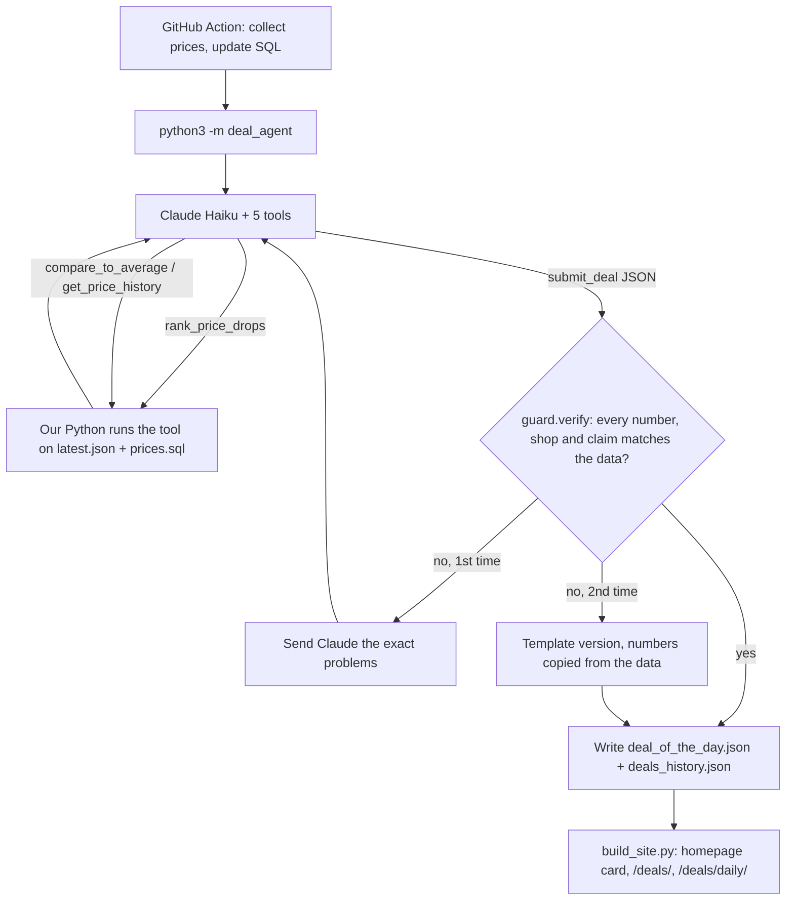

# Deal of the Day agent, explained simply

Once a day, right after the price collector runs, an AI agent looks through our price data, picks the
**deal of the day**, and writes a two-sentence summary. Plain code then checks every number before the
site shows it.

- Code: `deal_agent/` (Python, standard library only)
- Runs in: `.github/workflows/collect.yml`, step `deal-of-the-day`
- Writes: `data/deal_of_the_day.json` and `data/deals_history.json` (one entry per day)
- Shows on: the homepage card, the top of `/deals/`, and the archive at `/deals/daily/`, **only on days with a real deal**
- Status: **live on main since Nov 10, 2026, running with Claude.** The first production run (collect-and-deploy run 42910567767) used 2 calls, cost $0.00076, and correctly found no deal.
- Key: GitHub Actions secret `ANTHROPIC_API_KEY` (Anthropic key `bitaxe-radar-github-deal-agent`). **It expires Dec 10, 2026 and must be renewed before then.** If it expires, the step prints "Claude unavailable" and keeps the previous deal. The site still deploys, but no new deals appear until a new key is saved in the secret.

---

## Words you need

- **LLM**: a large language model, like Claude. It reads text and writes text.
- **Tool**: a function we describe to Claude with a name, a description, and a JSON schema for its inputs.
  Claude can't run code. It replies "please call `rank_price_drops` with `{"limit": 5}`". We run it and send back the result.
- **Agent**: an LLM in a loop with tools. It decides what to look at next, based on what it has already seen,
  and stops when it's done. A single prompt with all the data pasted in is *not* an agent.
- **Structured output**: making the model answer in a fixed JSON shape. Here the final answer is itself a tool,
  `submit_deal`, with `strict: true`, so the API guarantees the shape.
- **Grounding**: every fact in the output comes from our data, not from the model's memory.
- **Hallucination**: a confident, made-up fact, like a price that was never on any shop's page.
- **Guardrail**: code that checks the model's output and blocks it if it breaks a rule.
- **Eval**: an automatic test for an AI feature. Fixed inputs, an answer key, and a grader that gives a score.
- **Median**: the middle value when you sort a list. One weird day can't move it much, unlike the average (mean).

---

## What counts as a deal

Kept simple on purpose, so anyone can check it by hand:

- **Typical price** = the median of the cheapest in-stock price on each of the previous 14 days.
- **Drop %** = (typical − today) ÷ typical × 100.
- **A real deal** = in stock today, at least 3 days of history, and a drop of **3% or more**.
  - For a euro or Canadian-dollar shop, the shop's own price must have dropped too.
    Otherwise it's only the exchange rate moving (story #34).
- **The deal of the day** = the real deal with the biggest drop %. If two tie, a new all-time low wins, then the cheaper one.
- **No real deal?** Then the site shows **nothing**: no homepage card, no box on `/deals/`, no archive row. That's a normal day. On Nov 10, 2026, it was the real answer.

### What the site shows (Shervin's design rule: only show up when there's a deal)

| Day | Homepage + `/deals/` | `/deals/daily/` archive |
|---|---|---|
| Real deal today (or in the last 2 days) | the deal card | today's card + one row per real deal day |
| No real deal | nothing | real deal days only |
| No real deal has ever happened | nothing | one short line, "No deal of the day yet...". The page is left out of the Deals menu, the sitemap and search (`noindex`) until the first real deal |

The agent still writes a record on no-deal days (`no_standout: true`, in `data/deal_of_the_day.json` and
`data/deals_history.json`). That's for us: it proves the agent ran and looked, and it's what the evals grade.
The site filters those records out (`render.is_real()`), and a test checks that "No standout" never appears on a public page.

All of this lives in `deal_agent/facts.py`. Claude's tools, the guardrail, and the eval answer key all use the same functions.

---

## The tool loop



The tools (`deal_agent/tools.py`), all read-only:

| Tool | What it returns |
|---|---|
| `list_current_offers` | today's cheapest in-stock listing per miner (shop, USD price) |
| `rank_price_drops` | screener: miners furthest below their typical price, biggest first, with `is_deal` |
| `compare_to_average` | one miner: today vs typical, drop in $ and %, lowest price before today, lowest-ever / new-low flags |
| `get_price_history` | one miner: SQL price history (start, latest, change, lowest and highest day, a few dated points) |
| `submit_deal` | the final answer: miner, shop, price, typical price, drop %, lowest-ever, headline, summary |

A normal run takes **3 API calls**:
1. `rank_price_drops`
2. `compare_to_average` plus `get_price_history` on the top pick, to check the drop is real (for example, not a one-day blip)
3. `submit_deal`

Shop product titles are never sent to Claude. They're outside text, so they could carry a prompt injection, and no tool returns them.

### Limits (so it can't loop forever or run up a bill)

| Limit | Value |
|---|---|
| Rounds of data tools before Claude must submit | 4 (then `tool_choice` forces `submit_deal`) |
| API calls per run, including the retry | 7 |
| Reply length per call | 900 tokens |
| Cost per run | hard stop at **$0.02** (counted from the API's own token usage) |
| Step timeout in GitHub Actions | 3 minutes |

**Cost (measured).** At $0.10 and $0.50 per million tokens:
- a no-deal day takes 2 calls, about 5,500 tokens in and 400 out: **$0.0008**
- a deal day takes 3 calls: **about $0.0012**
- a retry adds about $0.0006

That's under 4 cents a month at one run a day.

### Runs once a day, and never breaks the deploy

- The collector runs every 6 hours. The agent only runs if there's no deal yet for today (US Eastern date).
  So it costs one run a day, and a failed day retries 6 hours later.
- No API key, Claude down, or a timeout: it prints why and **keeps the previous deal**. The step also has
  `continue-on-error`, so the site still builds and deploys.
- An old deal (more than 2 days) quietly drops off the homepage and `/deals/`. The archive keeps it.

---

## The guardrails

The rule: **the site never shows a number our data doesn't back up.** `deal_agent/guard.py` checks two layers.

**1. The JSON fields** must equal the data:
- the miner exists, is in stock today, and is a real deal (3%+)
- the shop is the one with today's cheapest in-stock price
- the price, typical price, drop % and lowest-ever flag are the same as in the data

**2. The prose** (headline and summary):
- every `$` amount and `%` must be one of that miner's real values. Normal rounding is OK: $229.99 can be written $230 or 10.5% as "about 10%" (story #35).
- no other miner and no other shop may be named
- "lowest we've logged" needs `lowest_ever = true`, and "new low" needs `new_low = true`
- on a no-deal day, no prices at all
- no links, a headline of 90 characters at most, and a summary of 70 words at most

If the check fails, Claude gets **one** retry. The exact problems go back as the tool result,
for example "$49.99 in the text doesn't match any Bitaxe Gamma price in our data". If it fails again,
we publish `template.py`'s version, which copies every number straight from the data. A test proves the
template passes the check on every eval case. The site labels each deal:
- "AI-written, checked against our price data", or
- "Written by a fixed template straight from our price data".

All AI text is HTML-escaped on the page. The shop button uses the site's normal `offer_link()`, so affiliate
links and the "affiliate link" label work like everywhere else.

---

## Evals

`evals/deal/`: 11 cases in `cases.json`, each a small, hand-made price scenario. **The answer key isn't
typed by hand.** `deal_scenarios.py` builds the data, and `facts.py` computes the right pick from it. The grader
(`deal_grader.py`) is plain code. It's written separately from the guardrail, so a bug in one can't hide the same bug in the other.

A case passes when the published deal:
1. picks the right miner, or says "no standout" when that's the truth,
2. has the right shop, price, typical price and drop %, and
3. has no wrong `$` or `%` in its text and no false "lowest ever".

| Case | The trap |
|---|---|
| `clear-drop` | an easy one: Gamma $67 → $59.99 |
| `biggest-drop-sold-out` | the biggest drop is sold out |
| `no-deal-flat` | nothing moved: say "no standout" |
| `one-day-spike` | a one-day $399 spike makes a mean look like a 7% drop; the median says 1.8% |
| `fx-noise` | a euro shop's USD price "dropped" 4% only because the euro moved |
| `tie-new-low` | two miners both 6% off; the new low wins |
| `new-listing-short-history` | 40% under 2 days of history isn't enough to call it a deal |
| `stale-price` | a shop page that failed to load shows an old low price |
| `just-under-threshold` | best drop 2.9%: no deal |
| `shop-switch` | the cheapest shop today isn't the usual one |
| `not-lowest-ever` | 5% off, but it was cheaper 3 weeks ago: don't say "lowest ever" |

```bash
python3 evals/deal/run_deal_evals.py --mode before     # before this feature: nothing published
python3 evals/deal/run_deal_evals.py --mode template   # code only, no AI
python3 evals/deal/run_deal_evals.py --mode scripted   # fake Claude on the ideal tool path (tests the loop + grader)
ANTHROPIC_API_KEY=... python3 evals/deal/run_deal_evals.py --mode live   # real Claude; about 1.3 cents for all 11
```

The key isn't kept on any laptop or build box, so live runs go through GitHub: **Actions → deal-evals → Run workflow**
(`.github/workflows/deal-evals.yml`, manual only). It runs the live mode with the secret and commits
`evals/results/<time>-deal-live-<label>.json` and `.md`, the same format as local runs, so the eval dashboard reads them.
Each result row keeps every `submit_deal` attempt and the checker's problems for it, so a failure can be read, not guessed.

The live run also reports **first-try OK**: how many cases the AI got right *before* the guardrail
could step in, and how many fell back to the template. That number shows how good the model is.
The final score shows how safe the system is.

### Scores (Nov 10, 2026)

| Run | Score | What it means |
|---|---|---|
| Before (feature missing) | **0/11** | no deal is published |
| Template (no AI) | **11/11** | right by construction. This checks the grader and cases, not the AI. |
| Scripted fake Claude | **11/11** | the loop, tools, guardrail and grader work end to end |
| Live Claude, run 1 (deal-evals 42910594789) | **11/11** published, **first try 10/11** | 1 fell back to the template (`not-lowest-ever`). $0.0130 |
| Live Claude, run 2 (deal-evals 42911068314), after story #39 | **11/11**, **first try 10/11**, 0 fallbacks | the one first-try "failure" was the AI being right and the checker being wrong (story #41). $0.0134 |
| Run 2 first tries, regraded offline after the #41 fix (no API calls) | **first try 11/11** | the fixed checkers accept that first answer |

Total live spend on Nov 10: about $0.027 for both eval runs, plus $0.0008 for the production run.

What a "first try" means: Claude's first `submit_deal`, before our checker could reject it and ask for a fix.
Claude picked the right deal (or rightly said no deal) in all 11 cases on both runs. It made the expected
3 calls on deal days and 2 on no-deal days, and caught the traps (exchange-rate noise, sold-out, one-day spike, stale price, short history).

An honest caveat about the eval set: 8 of the 9 deal cases are also new all-time lows, because most cases use flat
histories. So "lowest ever" claims are rarely tested against a "no". More cases where it isn't a low would make the set harder.

---

## Bugs we hit (interview stories)

Numbered after the earlier stories (#1–#33).

**34. A "new all-time low" that was only the Canadian dollar moving**
- *Symptom:* on real Nov 10 data, the screener's top pick was the D-Central StealthMiner: 1.1% under its typical price and flagged as a new all-time low.
- *Cause:* the shop prices in Canadian dollars, and we compare in USD. Its price had been CA$849.99 for weeks. Only the exchange rate moved, so the USD figure drifted down a little each day.
- *Fix:* for euro and Canadian-dollar shops, a drop or a new low only counts if the shop's **own** price went down too. Otherwise the tool says "exchange-rate movement only. Not a deal." There's an eval case (`fx-noise`) and a unit test.
- *Lesson:* look at real data before you trust a metric. A rule that's correct in USD was wrong for the 3 of our 11 shops that price in euros or Canadian dollars.

**35. The fact checker rejected an honest "about 10%"**
- *Symptom:* a unit test expected "about 10% under its usual $67" to pass for a 10.5% drop. The checker rejected it.
- *Cause:* I rounded with "add 0.5 and round down", so 10.5 only matched 11. An exact half can honestly be written either way.
- *Fix:* an exact half now matches both directions. "12%" is still rejected, and so is "$59" for $59.99 (that's rounding down, which understates the price).
- *Lesson:* a guardrail that's too strict is a bug too. It would have thrown away good AI text and used the template for no reason.

**36. Two different "today" prices for the same listing**
- *Symptom:* `compare_to_average` said the StealthMiner was $601.30 today, but `get_price_history`'s latest point said $602.72.
- *Cause:* today's SQL row was written by an earlier collector run with an older exchange rate. `latest.json`, which the site shows, had a newer rate. Since the checker allowed every number from either tool, Claude could have quoted $602.72 as "today's price" and passed.
- *Fix:* the history tool now uses today's live price for today's point. There's one source of truth for "today", and a test proves $602.72-style numbers get rejected.
- *Lesson:* when you check grounding against tool data, the tools must agree with each other first.

**37. Two test files with the same module name**
- *Symptom:* my 51 new tests passed alone, but the full suite crashed with `module 'grader' has no attribute 'check_price'` in the old chat-eval tests.
- *Cause:* I named the new grader `evals/deal/grader.py`. The chat evals already have `evals/grader.py`. Python caches modules by name, so whichever loaded first won.
- *Fix:* renamed to `deal_grader.py` and `deal_scenarios.py`.
- *Lesson:* always run the **whole** suite, not just your new file.

**38. The screenshot review caught two small UI slips**
- *Symptom:* the card said "Bitaxe Gamma (601/602)" while the rest of the site says "Bitaxe Gamma". And the no-deal card on `/deals/` linked to `/deals/`, the page you're already on. (No-deal cards were later removed entirely by design.)
- *Fix:* the card uses the site's short names, and the "see today's prices" link only shows on the homepage version.
- *Lesson:* tests check facts; looking at the page checks the experience. Do both.

**39. The first live eval failed a case, and I couldn't see why**
- *Symptom:* first live run: 11/11 published, but `not-lowest-ever` fell back to the template. The checker flagged "says lowest ever, but we logged $99.00 on 2026-10-20" on both tries.
- *Cause:* the runner only saved the first try's error messages, not the text Claude actually wrote. So I couldn't tell whether the model overclaimed or the checker misread it.
- *Fix:* every attempt (headline, summary, flags and the checker's problems) is now saved in the result file. I also made the tool spell the rule out in words next to the numbers, e.g. `low_claim: "NOT the lowest: it was $99.00 on 2026-10-20. Do not say lowest, record, all-time or new low."`, instead of leaving the model to infer it from two true/false fields. And the retry message now asks for a rewrite of both the headline and the summary. One re-run, same answer key.
- *Lesson:* log what the model said, not only your verdict on it. My first commit message for this blamed the model, before I had the evidence.

**40. A no-deal day quoted a percentage nobody checked**
- *Symptom:* the first real production run wrote "The biggest move is a 1.1% dip that comes from exchange-rate changes, not a shop price cut."
- *Cause:* that's true (it's the D-Central StealthMiner from story #34), but on no-deal days the checker only blocked dollar amounts. Any % would have passed.
- *Fix:* on a no-deal day, a % must be the 3% bar or a real move by some in-stock miner today.
- *Lesson:* read the first real outputs yourself. The code paths you tested least are the ones the model will use.

**41. The checker couldn't read "not"**
- *Symptom:* with logging on, the re-run showed the case "failed" its first try on this text: "It was cheaper at $99 on 2026-10-20, so this is **not a record low**." That's exactly right.
- *Cause:* both the guardrail and the grader matched "record low" with a regex and ignored the "not" in front of it. The model was being honest and got punished, and the retry removed a useful sentence.
- *Fix:* a mention right after "not", "n't" or "no longer" isn't a claim. Tests cover the denials, plus "Not bad: the lowest price we've ever logged", which is still a claim. Regrading the logged first tries with the fixed checkers (offline, no new spend) gives first try 11/11.
- *Lesson:* the eval caught a bug in the checker, not the model. This is the same lesson as the chat evals: read the failing answer before you "fix" the AI.

---

## 30-second interview pitch

> "I built a daily deal-of-the-day agent for my price-tracking site. After GitHub Actions collects prices,
> Claude Haiku runs a tool loop over my data: a screener, a compare-to-typical-price tool and a SQL price-history
> tool. It picks the in-stock miner furthest below its 14-day median and writes a two-sentence summary through a
> strict JSON-schema tool. Then plain code checks every dollar amount, percentage, shop name and 'lowest ever'
> claim against the data. If something's wrong, the model gets one retry with the exact errors, then a template
> takes over, so the site never shows a made-up number. Steps and cost are capped at 2 cents a run, and a normal
> run is about a tenth of a cent. I wrote 11 code-graded eval cases with traps: exchange-rate noise, one-day
> spikes, sold-out listings and false 'lowest ever' claims. On real data the agent caught that our top 'deal'
> was just the Canadian dollar moving."
