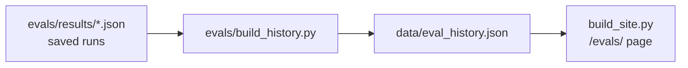

# Eval dashboard, explained simply

**One line:** A public page at `/evals/` that shows how the chat's automatic quizzes have scored over time, which questions failed, and how a code-based grader checks every answer.

This branch is not live yet. After it is approved and deployed, the page will be at [bitaxeradar.com/evals/](https://bitaxeradar.com/evals/).

---

## Why this page exists

A video about how AI teams work made a simple point: people who ship AI features also **check the AI's work**. Most portfolio sites only show a chat box. This page makes the checking visible: scores, before-and-after numbers, and the questions that failed, with the reason the grader gave.

It is a static page, built from files we already saved. Building it costs $0. It never calls Claude.

---

## Words you need

| Word | Plain meaning |
|---|---|
| **Eval** | An automatic quiz for an AI feature. Lots of questions, code-graded, one score. |
| **Suite** | One group of questions: Ask chat, price history, guide search (RAG), or the Deal of the Day agent. |
| **Code-based grader** | Ordinary code that checks an answer (regex, math, allowlists). Not another AI judging the AI. |
| **Answer key from data** | The right miner and price are looked up at run time from today's table or the price database, so the quiz does not break when prices change. |
| **Baseline / before** | The first score, before the feature or the fix. |
| **Regraded** | The same saved answers, scored again after a bug in the grader was fixed. The answers did not change. |

---

## What the page shows

- A score card for each suite, from the latest full run of that suite.
- Before-and-after numbers from named saved runs, for example price history **1/6 → 6/6** and guide search **0/11 → 12/12** (the after-run added a 12th general-knowledge case the citation bug had broken).
- A chart of full-suite scores over time.
- The latest run's pass/fail list for each suite, and why a failed question failed.
- A table of every saved run, including first grades, regrades, and partial re-checks, so a 3-question confirmation is not plotted as a perfect full-suite score.
- A short explanation of what each suite tests and how grading works.

Prompt-injection questions are shown only as a one-line summary. The exact wording, the hidden instructions, and the model’s answers are not on the page.

---

## How the numbers get there

1. Every eval run already writes `evals/results/<time>-<label>.json`.
2. `python3 evals/build_history.py` (or `python3 scripts/build_eval_history.py`) reads those files, plus any result file that only exists in git history, and writes `data/eval_history.json`.
3. `python3 evals/run_evals.py` calls the same rebuild after it saves a new run, so future scores are added automatically.
4. `python3 build_site.py` rebuilds the history file and renders `/evals/` at site-build time.

Scores are never typed in by hand. If a file is missing, that point is missing. The Deal of the Day suite appears when its saved result files are present (they landed on main with the deal-agent merge).

A run only counts toward a suite when enough of that suite's questions were actually asked. One overlapping case is not treated as a 1/1 suite score.

---

## Honest gaps

- The Deal of the Day **live Claude** run scored **11/11**. Ten cases passed on the first try; one used the template fallback. A later live run, after the low-price claim was spelled out, also scored 11/11, with no fallback. The scripted harness and no-AI template also scored 11/11.
- After launch, the live RAG re-check was **7/7** on a partial set (the questions that had just failed), not a full 11-question live run. The last full live RAG set was **9/11**.
- The later full-suite test-Worker run scored **47/48**. The one failure (`general-hashrate`) was a citation bug, then fixed, and re-checked as part of the 12/12 run.

## What a visitor sees first

The page opens with a plain-English summary and the after scores in large type (for example 32/32, with “started at 30/32” underneath), so a non-technical reader can get the story without scrolling. Failed questions are listed first; the full question list and the complete run table sit behind expand/collapse panels.

Light motion is there as a tasteful showcase: scores count up, charts draw themselves, before/after bars grow, and cards fade in as you scroll. It is vanilla CSS and a small `site/evals.js` file — no animation library. If the visitor has “reduce motion” turned on, the final state appears immediately and nothing moves.

---

## Bugs we hit (interview stories)

Numbered after the earlier stories (#1–#42, including the Deal of the Day stories on main).

**#43. A tag overlap would have invented a fake 1/1 RAG score.**  
The original 32 Ask cases include `general-solo-mining`. That case later also got a `rag` tag, when it was reused in the guide-search suite. If the dashboard had counted “any case with this tag,” every early Ask run would have shown RAG as 1/1 (or 0/1). That score was never measured. The builder now only attaches a suite score when enough of that suite's questions were actually in the run (6 or more for RAG and history, 3 or more for Ask confirmation re-runs, 32 for a full Ask chart point).

**#44. The first file is not always the official baseline.**  
The earliest Ask run file says **31/32**. After a grader bug was fixed, the same answers were regraded at **30/32**. If the page had used “first file by time” as the before score, it would have hidden a real prompt-injection miss and disagreed with the write-up. Both runs are kept, labelled, and the official before point is the regraded file.

**#45. Import order broke the whole site build.**  
`build_evals()` imported `render_dashboard` before it called `load_eval_history()`, which is the function that puts `evals/` on `sys.path`. The first site build died with `ModuleNotFoundError`, and no pages after that step (advertise, 404, home, the sitemap) were written. The import now adds the path itself, and the history rebuild is wrapped so a script failure cannot block the rest of the site.

**#46. The first animation pass hid the page from anyone without JavaScript.**  
Score cards started at `opacity: 0` until an IntersectionObserver added a class. With JavaScript off, a visitor (and a static screenshot) saw a blank area under the headline. Motion styles now apply only when CSS `scripting: enabled` and the visitor has not asked to reduce motion. Everyone else sees the finished page immediately.

