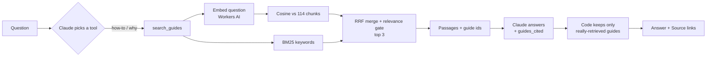

# RAG (guide search for the Ask chat), explained simply

**One line:** Before the chat answers a how-to or "why" question, it **looks up** the right paragraphs in our own guides, reads them, answers from them, and shows which guide it used.

Status: **live since Nov 10, 2026** (Worker `652413a3`). Built on branch `feature/ask-rag`.

---

## What RAG is

**RAG = Retrieval-Augmented Generation.**

- **Retrieval** = find the relevant text.
- **Augmented** = add that text to the prompt.
- **Generation** = the AI writes the answer from it.

Think of an open-book exam. Without RAG, Claude answers from memory: old, generic, sometimes wrong, and it can't say where it learned it. With RAG, we hand it the right page of *our* book first, and it answers from that page and cites it.

### Why it matters

1. **Fewer made-up answers ("hallucinations").** The model answers from text we gave it.
2. **Our own knowledge.** Claude doesn't know what *our* guides say, for example "AxeOS's fan aims for 60°C". RAG gives it that.
3. **Citations.** Every answer can show "Source: Is my Bitaxe normal?", so people can check it.
4. **Easy to update.** Edit a guide, rebuild the index, done. No retraining.
5. **"I don't know" works.** If nothing relevant is found, the bot says our guides don't cover it instead of guessing.

---

## Words you need

| Word | Plain meaning |
|---|---|
| **Chunk** | A small piece of a document, here about 900 characters (~200 tokens). We search chunks, not whole pages. |
| **Chunking** | Cutting documents into chunks. |
| **Overlap** | Each chunk repeats the last sentence of the one before, so an idea split by a cut still appears whole somewhere. |
| **Token** | A piece of a word. AI models count text in tokens. About 4 characters each. |
| **Embedding** | A list of numbers (ours: 384) that describes what a text *means*. Similar meaning gives similar numbers. |
| **Embedding model** | The AI that makes embeddings. Ours: `bge-small-en-v1.5`, run free on Cloudflare **Workers AI**. |
| **Vector** | Another word for that list of numbers. |
| **Cosine similarity** | A score from about 0 to 1 for how alike two embeddings are. 1 = same meaning. |
| **Keyword search** | Finding text that contains the same words. |
| **BM25** | The standard keyword-scoring formula (search engines used it for decades). Rare words count more than common ones. |
| **Hybrid search** | Using meaning search and keyword search together. |
| **RRF (Reciprocal Rank Fusion)** | A simple way to merge two ranked lists: each list gives every chunk `1 / (60 + its rank)` points, and we add them up. |
| **Top-k** | Keep only the best k results. Ours: k = 3. |
| **Index** | The prepared, searchable collection of chunks (and their embeddings). |
| **Vector database** | A database built to search millions of embeddings fast (e.g. Cloudflare Vectorize). We don't need one, see below. |
| **Grounded** | The answer's facts come from the retrieved text, not from the model's memory. |
| **Citation** | Saying which source an answer came from. |

---

## How our version works

```
OFFLINE (when guides change)                        ONLINE (every guide question)

site/guides/*.html  (14 pages)                      "Is 65°C normal for my Bitaxe Gamma?"
        |                                                     |
        v                                                     v
scripts/build_rag_index.py                          Claude picks the search_guides tool
  - keep the article text                           query: "Bitaxe Gamma normal temperature"
  - drop menus + live price columns                           |
  - cut into ~900-char chunks                    +------------+-------------+
    (by heading, 1-sentence overlap)             |                          |
        |                                        v                          v
        v                                  MEANING search             KEYWORD search
worker/src/rag_chunks.json                 embed the question         BM25 score for
  114 chunks, each with guide id,          (Workers AI), cosine       every chunk
  title, section, text                     vs all 114 chunks
        |                                        |                          |
        v   (first use, then cached)             +------------+-------------+
Workers AI embeds every chunk                                 v
  -> 114 x 384 numbers                              RRF merges the two rankings
  -> saved in KV (key = index version)              drop chunks with cosine < 0.6
                                                    keep top 3
                                                              |
                                                              v
                                                    3 passages + guide ids go back
                                                    to Claude as the tool result
                                                              |
                                                              v
                                                    Claude answers from them and
                                                    lists guides_cited
                                                              |
                                                              v
                                                    OUR CODE checks every citation
                                                    was really retrieved; adds
                                                    "Source: <guide>" links
```



### 1. Chunking (`scripts/build_rag_index.py`)

- Reads 13 guides plus the "how we track" page.
- Keeps only the article. Drops menus, breadcrumbs, scripts, the "updated ..." line and "Keep reading" link lists.
- **Drops live numbers.** Tables lose columns like "Today's price" or "Net /mo". Those change every few hours, and prices must come from the price tools, never from a guide.
- Cuts at each section heading. Long sections are cut on sentence boundaries into ~900-character pieces, with a one-sentence overlap. Tiny sections are glued to the next one.
- Each chunk keeps its guide id, title, section and URL, which is what makes citations possible.
- Result: **114 chunks from 14 pages.** The file also has a `version` (a fingerprint of all chunk text).

### 2. Embeddings (`worker/src/rag.js`)

- Model: `@cf/baai/bge-small-en-v1.5` on Workers AI. 384 numbers per text. Free daily allowance; one full re-embed of 114 chunks is a tiny fraction of it.
- We embed `title + section + text`, so a chunk "knows" which guide it's from.
- Questions get the prefix bge models expect ("Represent this sentence for searching relevant passages: "). The model was trained that way to match short questions to longer passages.
- **Cached:** in memory, and in KV under `rag:emb:<model>:<version>`. Edit a guide, and the version changes, so it re-embeds once by itself.

### 3. Retrieval

- **Meaning:** cosine similarity between the question and all 114 chunks. "Too loud for my bedroom" finds the noise guide without the word "noise".
- **Keywords:** BM25. Good at exact terms like `BM1370`, `AxeOS`, `XT30` that embeddings can blur.
- **Merge:** RRF, which uses ranks, not raw scores, so we never compare a cosine (0 to 1) with a BM25 score (0 to 20+).
- **Relevance gate:** a chunk must have cosine ≥ 0.6, or it's dropped. If nothing passes, the tool tells Claude "No guide covers this."
- **Why no vector database?** 114 × 384 numbers is tiny. Comparing against all of them takes well under a millisecond. Vectorize makes sense at millions of chunks.
- If Workers AI is down, search falls back to keyword-only, so the chat never breaks.

### 4. Generation and citations

- `search_guides` is a **tool**, like the price tools. Claude calls it for how-to, why, what-is and "is this normal" questions. Price questions don't pay for a guide search they don't need. (Called "agentic RAG": the model decides when to retrieve.)
- The answer has a new field, `guides_cited`.
- **Code checks citations:** a cited guide counts only if `search_guides` actually returned it in this question. Made-up or remembered citations are dropped. The site then shows "Source: <guide title>" links.
- Prompt rules: answer from the passages; if they don't answer it, say our guides don't cover it and don't make up specifics; never quote a price from a guide.

### How the 0.6 cutoff was picked

We measured real cosine scores on 11 test questions:

| Question | Best chunk | Cosine |
|---|---|---|
| Is 65C normal for my Bitaxe Gamma? | is-my-bitaxe-normal | 0.80 |
| What power supply do I need for a Gamma? | bitaxe-power-supply | 0.79 |
| Can I mine with solar panels? | solar-bitcoin-mining | 0.77 |
| How do I update the firmware? | bitaxe-firmware | 0.75 |
| How do you get your prices? | how-we-track | 0.63 |
| How do I replace thermal paste on an Antminer S19? *(not covered)* | is-my-bitaxe-normal | 0.58 |
| What is the capital of France? *(off-topic)* | bitaxe-chips | 0.38 |

Relevant chunks scored 0.63 to 0.80. Unrelated ones scored 0.58 or less. 0.6 sits in the gap.

---

## Evals

11 RAG cases (`rag` tag in `evals/cases.json`), all code-graded:

- **Retrieved:** did `search_guides` return a passage from the right guide? (retrieval quality)
- **Cited:** does `sources` include that guide? (citation)
- **Grounded:** does the answer contain the guide's facts, e.g. "60°C", "5V", "every 6 hours"? (faithfulness)
- **I don't know:** for 2 questions our guides don't cover (Antminer S19 thermal paste, Home Assistant), it must say so, and must not invent steps (e.g. no "HACS", "YAML").

| Run | RAG cases |
|---|---|
| Before (live Worker, no guide search) | **0/11** (27/57 checks) |
| After, first run (test Worker) | 10/11. Grader too strict on "I don't know" (story 5) |
| Full suite, all 48 cases | 47/48. `general-hashrate` mislabeled (story 7) |
| After both fixes (RAG + general cases) | **12/12** (62/62 checks) |
| Live, after launch (Nov 10) | 9/11 RAG cases (17-case smoke run incl. history: 15/17). `rag-solar` and `rag-how-often`: grounded, cited answers labeled `in_data: false` (story 8) |
| Live, after story-8 fix | **7/7** on the re-check (the 2 failures, the "I don't know" cases, hashrate, firmware, solo mining) |

Cost: about $0.001 per question on Claude, and Workers AI is inside the free allowance.

---

## Bugs we hit (interview stories)

**1. Guides contained live prices**
- *Symptom:* while checking chunks, I saw text like "Cheapest in stock: $119.99" inside guide passages.
- *Cause:* the guides show today's prices in tables. Frozen into the index, they'd go stale within hours, and the chat could quote them.
- *Fix:* the chunker drops table columns about price, stock or money per month, and the prompt says never take a price from a guide. A test fails if "Cheapest in stock:" ever shows up in a chunk.

**2. A merged chunk had the wrong heading**
- *Symptom:* a unit test expected the first chunk to be labeled "Intro", but it said "Noise table".
- *Cause:* tiny sections get glued to the next one, and the glued chunk took the *last* section's heading, so the citation pointed at the wrong part of the page.
- *Fix:* label a glued chunk with the heading where its text **starts**.

**3. Keyword search said an unrelated guide was relevant**
- *Symptom:* "How do I replace the thermal paste on an Antminer S19?" scored a strong BM25 9.0 on the "Is my Bitaxe normal?" guide.
- *Cause:* that guide mentions "dried-out thermal paste" on a Bitaxe. Keywords match words, not meaning.
- *Fix:* with embeddings on, the relevance gate uses meaning only (cosine 0.58, under the 0.6 cutoff). Keywords still help rank, but they can't make an unrelated chunk "relevant". The eval case now passes: "Our guides don't cover replacing thermal paste on an Antminer S19."
- *Lesson:* this is exactly why hybrid search exists. Each method covers the other's blind spot.

**4. "Gamma's" became two words**
- *Symptom:* a tokenizer test got `["gamma", "s", "fans", "loud"]`.
- *Cause:* the apostrophe split "Gamma's", and the plural rule only applied to words over 4 letters.
- *Fix:* strip `'s` first and stem from 4 letters ("fans" → "fan").

**5. The grader was too strict on "I don't know"**
- *Symptom:* the Home Assistant case failed, but the answer was good: "Our guides don't cover a Home Assistant connection directly. What they do cover: ... open that IP address in a browser to reach the AxeOS dashboard."
- *Cause:* my check said "if it says not covered, it must cite nothing". But it cited the setup guide for the *related* facts it gave, which is correct.
- *Fix:* the check only requires saying it isn't covered. Made-up specifics are caught per case instead (no "HACS", "YAML", "MQTT").
- *Lesson (same as the first eval round):* read the failing answer before "fixing" the bot. Sometimes the test is wrong.

**6. Re-grading lost the citations**
- *Symptom:* re-grading saved answers with the fixed grader scored 2/11, worse than the live run.
- *Cause:* the runner didn't save the new `sources` field, so re-graded answers had no citations.
- *Fix:* save and restore `sources` in results.

**7. A citation made general knowledge look "from our data"**
- *Symptom:* the full eval run was 47/48. "What is hashrate?" came back labeled `in_data: true`, but the answer itself said "Our guides don't give a full definition, so this is the general meaning."
- *Cause:* Claude cited the chips guide anyway, and my code flipped `in_data` to true whenever there was a citation. The site would have shown "From our guides" on a general-knowledge answer.
- *Fix:* citations no longer flip `in_data`; only Claude's own label (or real price-tool data) decides it. A unit test locks it in.
- *Lesson:* code that "corrects" the model can also be wrong. The eval caught my override, not the model.

**8. Fixing story 7 brought back the opposite mislabel**
- *Symptom:* on the live site, the solar and "how often" answers were correct and cited, but labeled `in_data: false`.
- *Cause:* once code stopped overriding the label, Claude's own label was the only one left. The `in_data` description only listed price facts ("prices, specs, shops"), so Claude didn't count guide passages as our data.
- *Fix:* the description now names search_guides passages, and says "false" means general knowledge, including "our guides don't cover it". The live re-check went 7/7, with labels right in both directions.
- *Lesson:* fix the instruction the model reads, not just the code around it. And rerun both kinds of case, because a fix in one direction can break the other.

---

## 30-second interview pitch

> "I added RAG to my site's Claude chat. An offline script chunks 14 guide pages into 114 passages of about 200 tokens, by heading with a one-sentence overlap, and strips live prices so the index never goes stale. At run time, a search_guides tool does hybrid retrieval: Workers AI bge-small embeddings with cosine similarity, plus BM25 keywords, merged with reciprocal rank fusion, then a relevance cutoff I tuned from measured scores, top 3. Claude answers from those passages and cites guide ids, and my code drops any citation that wasn't actually retrieved. I built 11 code-graded evals for retrieval, citation, grounding and 'I don't know'. It went from 0 of 11 to passing, and the evals caught a keyword false-positive that made me gate relevance on meaning only."
