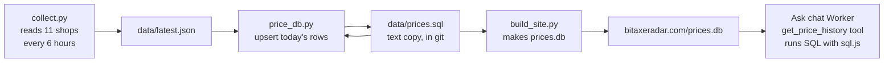

# SQL price history, explained simply

**One line:** Every day we save each shop's price for each miner into a real database. The Ask chat can then answer "has the Bitaxe Gamma gotten cheaper this month?" by running a SQL query on it.

Status: **live since Nov 10, 2026** (Worker `652413a3`). Built on branch `feature/sql-price-history`.

---

## Words you need

| Word | Plain meaning |
|---|---|
| **Database** | An organized place to store data so you can ask it questions fast. |
| **Relational database** | A database made of **tables** that point at each other. "Relational" = the tables are related. |
| **SQL** | "Structured Query Language". The language you use to ask a relational database questions. Say "sequel" or "S-Q-L". |
| **SQLite** | A small, free relational database that lives in **one file**. No server to run. Phones, browsers and planes use it. |
| **Table** | Like one spreadsheet tab: rows and columns. |
| **Row** | One record, e.g. "Bitaxe Gamma at Solo Satoshi on Nov 10 cost $67". |
| **Column** | One kind of fact, e.g. `price_usd`. |
| **Schema** | The plan of the database: which tables, which columns, what type each column is. |
| **Primary key** | The column that gives each row a unique name, like `bitaxe-gamma`. No two rows can share it. |
| **Foreign key** | A column that points at a primary key in another table. `offers.miner_id` points at `miners.id`. It stops "orphan" rows that point at nothing. |
| **Index** | Like the index at the back of a book. Lets the database find rows without reading every row. |
| **UNIQUE** | A rule: no two rows may have the same value(s) here. |
| **Query** | One question written in SQL. |
| **JOIN** | Glue two tables together in one query, matching a foreign key to a primary key. |
| **Upsert** | "Insert, or update if it's already there." In SQL: `INSERT ... ON CONFLICT DO UPDATE`. |
| **Idempotent** | Safe to run twice. Running it again gives the same result, no duplicates. |
| **Backfill** | Filling the database with older data you already had. |
| **Parameter / placeholder** | A `?` in a query that gets filled in separately. Keeps typed text from changing the query (stops "SQL injection"). |
| **SQL injection** | An attack where someone types SQL into a box, hoping your code pastes it into a query. Placeholders block it. |
| **WebAssembly (WASM)** | A way to run compiled programs (like SQLite, written in C) inside a browser or a Cloudflare Worker. |
| **sql.js** | SQLite compiled to WebAssembly. It lets our Worker run real SQL. |

---

## The 4 tables

```
retailers                 miners
---------                 ------
id (primary key)          id (primary key)
name                      name, maker, chip
url, currency             hashrate_ths, watts
     ^                         ^
     |                         |
     +-------- offers ---------+        one product page = one miner at one shop
               ------
               id (primary key)         e.g. 'solosatoshi:bitaxe-gamma'
               miner_id     -> miners.id      (foreign key)
               retailer_id  -> retailers.id   (foreign key)
               title, url
                  ^
                  |
           price_snapshots              one row per offer per day
           ---------------
           id (primary key)
           offer_id -> offers.id        (foreign key)
           day          'YYYY-MM-DD'
           checked_at   exact time we read it
           price, currency, price_usd
           in_stock     1 or 0
           UNIQUE (offer_id, day)       <- max ONE row per offer per day
```

**Why split it into 4 tables?** So each fact lives in one place. The Gamma's name is stored once in `miners`, not copied into 1,000 price rows. If we fix a name, it's fixed everywhere. This is called **normalizing**.

**Indexes:** `idx_offers_miner` (find all of one miner's offers fast) and `idx_snap_day` (find all prices from a date range fast). `UNIQUE (offer_id, day)` also makes an index for free.

---

## How data gets in



1. `collector/collect.py` reads every shop (unchanged).
2. `collector/price_db.py` adds the new readings to the database. It runs right after the collector in the GitHub Actions workflow.
3. The database is saved as **text** (`data/prices.sql`, one `INSERT` line per row) and committed to git.
4. `build_site.py` turns the text into a real SQLite file, `site/prices.db`, published with the website.
5. The Ask chat downloads `prices.db` (cached 10 minutes) and runs SQL on it.

**Why save a text copy and not the `.db` file in git?** A `.db` file is binary. Git can't store "just the change", so every update would add a whole new 250 KB copy, 4 times a day. The text copy only grows by the new lines.

### Why it's idempotent (safe to run twice)

Each write is an **upsert** keyed on `UNIQUE (offer_id, day)`:

```sql
INSERT INTO price_snapshots (offer_id, day, checked_at, price, currency, price_usd, in_stock)
VALUES (?, ?, ?, ?, ?, ?, ?)
ON CONFLICT (offer_id, day) DO UPDATE SET price = excluded.price, ...
WHERE excluded.checked_at > price_snapshots.checked_at;
```

In plain words: "Add today's row for this listing. If there's already a row for today, replace it, but only if this reading is newer."

- Run it twice with the same data: nothing changes (a test checks the text copy is byte-for-byte the same).
- The collector runs 4 times a day: we keep the newest reading of each day.
- Feed in old data after new data: the old reading never overwrites the new one.
- Prices from a shop that failed to load ("stale") are skipped. We only store prices we really read.

### The backfill

The database started on Nov 10, but we had history back to Oct 16 in two places:

- `data/history.json` (a price point each time something changed).
- Git history: every old version of `data/latest.json` (159 versions, about 4 per day).

`python3 collector/price_db.py --backfill-git` read all of them. Result: **1,345 rows, every day from Oct 16 to Nov 10, 67 listings, 37 miners, 11 shops.**

---

## Example queries

Run these yourself: `sqlite3 data/prices.db` (after `python3 collector/price_db.py`), then paste a query.

### 1. Lowest price ever (Bitaxe Gamma)

```sql
SELECT s.day, r.name AS shop, s.price_usd
FROM price_snapshots s
JOIN offers o    ON o.id = s.offer_id       -- each price row -> its listing
JOIN retailers r ON r.id = o.retailer_id    -- each listing -> its shop
WHERE o.miner_id = 'bitaxe-gamma'
  AND s.in_stock = 1                        -- out-of-stock prices don't count
ORDER BY s.price_usd ASC, s.day ASC         -- cheapest first; earliest day breaks ties
LIMIT 1;                                    -- just the top row
```

Result (Nov 10): `2026-10-21 | Solo Satoshi | 67.0`

### 2. 30-day change (cheapest in-stock price per day, first day vs last day)

```sql
WITH daily AS (                             -- WITH = a named temporary result ("CTE")
  SELECT s.day, MIN(s.price_usd) AS cheapest
  FROM price_snapshots s
  JOIN offers o ON o.id = s.offer_id
  WHERE o.miner_id = 'bitaxe-gamma' AND s.in_stock = 1
    AND s.day >= date('now', '-30 days')
  GROUP BY s.day                            -- one row per day
)
SELECT
  (SELECT cheapest FROM daily ORDER BY day ASC  LIMIT 1) AS first_price,
  (SELECT cheapest FROM daily ORDER BY day DESC LIMIT 1) AS latest_price;
```

Result (Nov 10): `119.99 | 67.0`, so it got $52.99 cheaper.

### 3. Cheapest shop over time (how many days each shop was the cheapest)

```sql
SELECT r.name AS shop, COUNT(*) AS days_cheapest
FROM price_snapshots s
JOIN offers o    ON o.id = s.offer_id
JOIN retailers r ON r.id = o.retailer_id
WHERE o.miner_id = 'bitaxe-gamma' AND s.in_stock = 1
  AND s.price_usd = (                       -- a "subquery": that day's lowest price
    SELECT MIN(s2.price_usd)
    FROM price_snapshots s2 JOIN offers o2 ON o2.id = s2.offer_id
    WHERE o2.miner_id = 'bitaxe-gamma' AND s2.in_stock = 1 AND s2.day = s.day)
GROUP BY r.name
ORDER BY days_cheapest DESC;
```

Result (Nov 10): Solo Satoshi 20 days, Bitcoin Merch 5, Power Mining 1.

---

## How the Ask chat uses it

The chat already had 3 tools (`search_miners`, `get_miner`, `compare_miners`). Now it has a 4th: **`get_price_history`** (`worker/src/history.js`).

1. Visitor: "Has the Bitaxe Gamma gotten cheaper this month?"
2. Claude picks `get_price_history` with `{"miner": "Bitaxe Gamma", "days": 30}`.
3. Our code turns "Bitaxe Gamma" into the id `bitaxe-gamma` (same matcher as the other tools).
4. It runs 4 SQL queries with `?` placeholders: the date range, the cheapest price per day, the all-time low, and each shop's lowest price plus days it was cheapest.
5. It sends Claude a small summary (start price, latest price, change, lowest, highest, by shop, up to 8 dated points), not 1,000 rows.
6. Claude answers: "Yes. It dropped from $119.99 on Oct 16 to $67 on Nov 10, down $52.99 (about 44%)."

"This month" is counted back from the **newest day in the database**, not the clock, so answers always match the data we have.

**Cloudflare D1 (later):** D1 is Cloudflare's hosted SQLite. It would remove the file download. Our Cloudflare API token doesn't have D1 permission yet, so we used sql.js. The tool talks to the database through one small adapter (`all(sql, params)`), so switching to D1 changes only that adapter.

---

## Tests and evals

- `tests/test_price_db.py` (7 tests): the schema has its keys and indexes, running twice changes nothing, the newest reading of a day wins in any order, history only fills empty days, the text copy round-trips, and the committed database has no broken foreign keys and no duplicate days.
- `worker/test/history.test.mjs`: Python builds a small database, then the Worker's JavaScript queries it. Both languages must agree on the schema. It also tries an SQL injection (`x'; DROP TABLE price_snapshots; --`), and the table is still there.
- 6 new eval cases (`hist-*` in `evals/cases.json`). The grader works out the right answer with **its own** SQL in Python, from the same database file the Worker reads.

| Run | Score (6 history cases) |
|---|---|
| Before (live Worker, no history tool) | 1/6. It could only say today's price. |
| After (test Worker `bitaxe-radar-ask-preview`) | 6/6 (33/33 checks) |
| Live, after launch (Nov 10) | 6/6 |

---

## Bugs we hit (interview stories)

**1. "__dirname is not defined" (the Worker thought it was Node)**
- *Symptom:* sql.js crashed the moment it started inside the Cloudflare Worker.
- *Cause:* sql.js decides "am I in Node?" by checking `process.versions.node`. Cloudflare Workers now have that too (for Node compatibility), so sql.js tried to load its `.wasm` file using Node's file system, which a Worker doesn't have.
- *Fix:* use sql.js's **browser** build, which has no Node branch, and hand it the WebAssembly module ourselves.

**2. "Cannot read properties of undefined (reading 'href')"**
- *Symptom:* the browser build crashed too, but only in the real Worker, not on my laptop.
- *Cause:* it saw a "web worker" and read `self.location.href` to find its files. Browser workers have a `location`; Cloudflare Workers don't.
- *Fix:* set a placeholder `location` before loading sql.js. We pass the `.wasm` in directly, so the URL is never used.
- *Lesson:* test in the real runtime early. A test Worker under a different name found this in minutes.

**3. "no such table: price_snapshots" (an empty database)**
- *Symptom:* all unit tests passed, but the test Worker said every history lookup failed.
- *Cause:* a one-line wrapper, `async (bytes) => openDb(bytes)`, passed on only the first argument. The SQL text was the second, so sql.js opened an empty database. The unit tests called `openDb` directly and skipped the wrapper.
- *Fix:* `(...args) => openDb(...args)`, plus a test for the wrapper itself.
- *Lesson:* test the exact path production uses, not a shortcut around it.

**4. Eval case too strict about the tool input**
- *Symptom:* a correct answer failed because Claude called the tool with `"NerdQaxe++"` and the case expected `"nerdqaxe-pp"`.
- *Cause:* the tool accepts names **or** ids on purpose, but the case only allowed the id.
- *Fix:* those cases check the tool name only. The price checks already prove it looked up the right miner.

**At launch** we ran `python3 collector/price_db.py --backfill-git` on `main` (nothing to add: the merge was the same day), and the scheduled workflow's new `price_db.py` step ran green.
