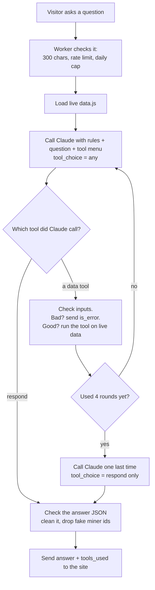

# Tool calling, explained simply

**One line:** Before, we pasted the whole price list into every question. Now Claude gets a short menu of lookups ("tools"), picks the one it needs, our code runs it, and Claude answers from the result.

Branch: `feature/ask-tool-calling`. Not live yet. Shipping it needs Shervin's yes.

---

## The idea in 20 seconds

- **Old way:** "Here are all 37 miners. Now answer: what's the cheapest Bitaxe?"
- **New way:** "You can search miners, look one up, or compare a few. What's the cheapest Bitaxe?"
  - Claude: "Please run `search_miners` with brand=Bitaxe, sort by price."
  - Our code runs it and sends back the top 3.
  - Claude: "The Bitaxe Gamma, $67 at Solo Satoshi."

It's like a waiter (Claude) who can't go into the kitchen. The waiter writes an order ticket. The kitchen (our code) makes the dish and hands it back. The waiter serves it.

---

## Words you need (every one)

| Word | Plain meaning |
|---|---|
| **Tool** | A small function in *our* code that Claude may ask us to run. Claude never runs code itself. It only asks. |
| **Tool schema** | The tool's "order form": its name, a description of when to use it, and the exact inputs allowed (written as JSON Schema). Example: `sort_by` must be one of `price`, `price_per_th`, `efficiency`, `hashrate`. |
| **strict: true** | Tells the API to make Claude fill out the form correctly: right field names, right types. It can't check ranges like "limit is 1–10", so our code checks those. |
| **tool_use** | Claude's order ticket: a block in its reply saying "run `search_miners` with these inputs". Each one has an id. |
| **tool_result** | Our answer to one ticket: the data, sent back with the same id. If the inputs were bad we set `is_error: true` and say why, so Claude can fix them and try again. |
| **stop_reason** | Why Claude stopped writing. `tool_use` = "I'm waiting for a tool result." `end_turn` = "I'm done." `max_tokens` = "I ran out of room." `refusal` = "I won't answer that." |
| **Agent loop** | The back-and-forth: call Claude → it asks for a tool → we run it → send the result → call Claude again → … until it answers. Agents are this loop, plus more tools. |
| **Round** | One trip through the loop where Claude asks for tools. |
| **Round cap** | The most rounds we allow (4). After that, Claude *must* answer. It stops a confused model from looping forever and running up the bill. |
| **tool_choice** | A setting for each call. `any` = "you must use some tool." `{name: "respond"}` = "you must use *this* tool." |
| **respond tool** | Our special "I'm done" tool. Its inputs are the answer itself (`working`, `answer`, `models_mentioned`, `confidence`, `in_data`). Calling it ends the loop. |
| **Token** | A word-piece. Claude bills per token in (what we send) and out (what it writes). |
| **Latency** | How long the visitor waits. |

---

## The loop (picture)

---

## The 3 data tools (+ respond)

| Tool | What it's for | Example inputs |
|---|---|---|
| `search_miners` | Rank miners: cheapest, priciest, best $/TH, most efficient, most TH/s. Filters for budget, min TH/s, brand. Max 10 results. | `{sort_by: "price", brand: "Bitaxe", limit: 3}` |
| `get_miner` | Everything about ONE miner: specs, every shop listing, price, stock. | `{miner: "Canaan Avalon Q"}` |
| `compare_miners` | 2–4 miners side by side. | `{miners: ["Bitaxe Gamma", "NerdQaxe++"]}` |
| `respond` | The final answer. Same JSON shape the site already reads. | `{answer: "...", models_mentioned: ["bitaxe-gamma"], ...}` |

All tools run **inside our Worker** over the same live `data.js`. There are no new outside calls, so there's nothing new to break or pay for.

Tool results leave out shop URLs on purpose. The site adds links itself, and URLs in the data tempt Claude to paste them.

---

## Why a "respond" tool? (a design choice you can explain)

Before, we forced the answer shape with **structured output** (`output_config.format`). We kept it on at first, and it broke tool calling. Claude wrote JSON right away and only *described* the tool call ("Calling search_miners…") with an empty answer.

The fix: make the final answer a tool.
- `tool_choice: any` means Claude must call a tool every turn: a data tool, or `respond`.
- At the round cap we force `respond`.
- `strict: true` on `respond` guarantees the same JSON shape as before, so the website didn't change at all.

One way out of the loop. Easy to test.

---

## Safety rails (all the old ones stay)

- 300-character question limit, per-visitor rate limit, **200 questions/day** cap (still counted **once per question**, even if that question makes 2–5 Claude calls).
- **Round cap 4**, then a forced answer. Worst case is 5 Claude calls per question.
- **25-second total timeout** for the whole question. Each call gets at most 20 s, less if time is running out.
- Every tool input is checked in code (range, length, unknown fields, unknown tool name). Bad input goes back as `is_error`, never a crash.
- Answer checks: fake miner ids dropped, leaked markup cut off, empty answers rejected.
- Chat history (follow-ups) still works. The short 2–4 sentence rule still applies.
- **Kill switch:** set `ASK_TOOLS = "off"` in `wrangler.toml` to go back to the old "paste all data" way.

---

## Live results (real Claude, Nov 9 2026, not deployed)

Same 6 questions, both ways, model claude-haiku-5-5. Cost is at $0.10 per million tokens in and $0.50 per million out.

| Question | Old way | Tool way | Tools used |
|---|---|---|---|
| Cheapest Bitaxe | ✅ 2.2 s, $0.00051 | ✅ 4.0 s, $0.00069 | search_miners |
| Best miner under $200 per TH/s | ❌ **ran out of tokens** (502), $0.00087 | ✅ 2.7 s, $0.00073 | search_miners |
| Compare the Gamma and the NerdQaxe++ | ✅ 3.7 s, $0.00055 | ✅ 3.4 s, $0.00067 | compare_miners |
| Most expensive miner | ✅ 1.3 s, $0.00046 | ✅ 3.1 s, $0.00069 | search_miners |
| → "why is it so expensive?" (follow-up) | ✅ 1.9 s, $0.00051 | ✅ 3.2 s, $0.00068 | get_miner |
| write me a cat poem | ✅ refused, 1.1 s, $0.00044 | ✅ refused, 1.7 s, $0.00034 | none |
| **Total** | **5/6, $0.0033** | **6/6, $0.0038** | |

**Honest takeaways:**
- **Cost:** tool calling is about **14% more** right now: ~$0.0007 vs ~$0.0006 per question. Most questions take 2 calls, and each call re-sends the rules + tool menu (~2,100 tokens). The old way sent ~3,700 tokens once.
- **Speed:** about 1 second slower on average (2 calls instead of 1).
- **Accuracy:** better. The old way failed the $/TH question because Claude did the math by hand and ran out of room. The tool does the math in code.
- **Scale:** the old way's prompt grows with every miner we add (~100 tokens each). The tool way stays flat. At about 50+ miners, tools become the cheaper option too.
- **Worst case:** 5 calls × ~3k tokens ≈ $0.0015 per question. 200/day × 30 days ≈ $9/month, still under the $10 Anthropic spend cap.

One thing to watch: "Best miner under $200 per TH/s" picked `sort_by: efficiency` instead of `price_per_th`. The answer still came out right, but it's a good case to add to the eval set (the next project).

---

## Exact steps I took

1. Made a separate copy of the code on its own branch: `git worktree add /workspace/br-tools -b feature/ask-tool-calling`. Nothing live changes.
2. Wrote `worker/src/tools.js`: 3 tool definitions (name, description, strict schema), an input checker, and the tools themselves over the live data.
3. Changed `worker/src/ask.js`:
   - added `runAgentLoop()` (the loop, round cap 4, 25 s timeout, adds up tokens across calls)
   - added the `respond` tool
   - changed rule 1 of the system prompt from "use the data below" to "use the data from your tools… then call respond"
   - kept the old way behind `ASK_TOOLS=off`
4. Wrote `worker/test/tools.test.mjs` with a **mocked** Claude: a fake that replies from a script, so tests are free and repeatable. It covers: happy path, two tools at once, bad inputs, unknown tool, round cap, forced final still failing, off-topic refusal, follow-ups, daily cap counting, timeout, kill switch, leaked markup.
5. Ran the 6 questions against **real** Claude with `scripts/try_ask.mjs`, which calls the same code the Worker uses. Found bug #14 (Claude described tools instead of calling them) and fixed it with the `respond` tool.
6. Re-ran and found bug #15 (markup leaked into an answer), fixed it, and added a test.
7. Ran the old way on the same 6 questions to compare cost honestly. Found #16 (the old way runs out of tokens on math).
8. Ran the real Worker locally with `wrangler dev`, with the key in a git-ignored `.dev.vars` file that was deleted afterward, and asked it 3 questions over HTTP. All worked. Production was never touched.
9. Wrote this doc and added bugs #14–#16 to `BUILD_LOG_ASK.md`.

---

## How to ship it (only after Shervin says yes)

1. `cd worker && npm test`: all tests must pass.
2. Merge the branch: `git checkout main && git merge feature/ask-tool-calling && git push`.
3. Deploy the Worker: `cd worker && npx wrangler deploy`. It prints a new Worker version id. GitHub Actions only rebuilds the website, and the website doesn't change here. No new secrets, no new KV.
4. Check it live in a private tab: "Cheapest Bitaxe" should answer, and the network response should show `tools_used: [search_miners]`.
5. **Undo if needed:** set `ASK_TOOLS = "off"` under `[vars]` in `worker/wrangler.toml` and run `npx wrangler deploy` again. Or use `npx wrangler rollback` to go back to the previous Worker version.

---

## Say it in an interview (30 seconds)

> "My site's chatbot used to paste the whole price list into every prompt. I switched it to tool calling. Claude gets three lookup tools with strict schemas, and my Worker runs an agent loop: Claude asks for a tool, I validate the inputs, run it on live data, and send the result back. I cap it at 4 rounds and 25 seconds. The final answer is itself a strict 'respond' tool, because I found that forcing JSON output stopped Claude from calling tools at all. I measured it honestly: about 14% more cost per question at today's catalog size, but it fixed a question the old version failed, because the math moved into code. And it scales flat as the catalog grows."
